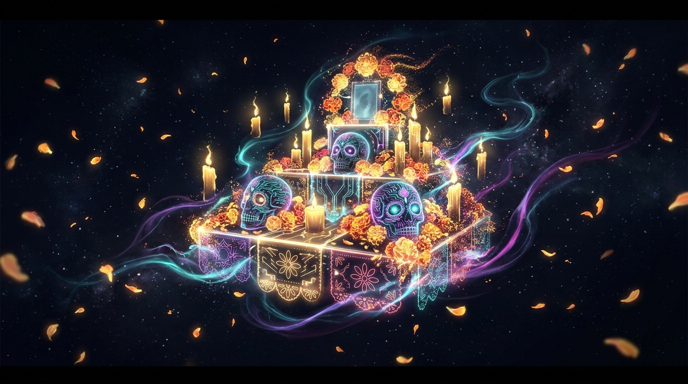

*This is a submission for the [Hacktoberfest Open-Source AI Challenge Week 4: Ghost in the Machine](https://dev.to/challenges/hacktoberfest-week4-2026-10-26)*

---

## What I Built

In Mexican tradition, Día de los Muertos (November 1 & 2) reminds us that *“the dead are never truly gone as long as they are remembered.”* Families assemble **ofrendas** (altars) adorned with marigolds (*cempasúchil*), flickering candles (*veladoras*), sweet *pan de muerto*, copal incense, and personal keepsakes to welcome spirits back to the earthly plane.

For the **Ghost in the Machine** theme, I built **Spiritus**: an open-source, air-gapped, privacy-first virtual ofrenda builder and remembrance writer powered by open-weight AI (**Gemma 3** via **Ollama**).

```
                      🕯️   🌼   🕯️
               ┌───────────────────────────┐
               │    S P I R I T U S        │
               │   Virtual Ofrenda Altar   │
               │      & Memory Vault       │
               └─────────────┬─────────────┘
                             │
     Local Open-Weights      ▼      Real-Time SSE
      (Gemma 3 / Ollama) ─────────► Token Streaming
                             ▲      + Web Speech TTS
                             │
               ┌─────────────┴─────────────┐
               │  Zero Telemetry · 100%    │
               │  Air-Gapped & Offline     │
               └───────────────────────────┘
```

### Key Highlights:
- 🕯️ **Interactive Living Altar**: Dynamically arrange traditional offerings (candles, marigold petals, pan de muerto, mezcal, family photos, and handwritten mementos) with a live canvas particle simulation that scatters golden petals across the screen.
- 🪶 **Tuned Remembrance Generator**: Feeds offering details, beloved nicknames, milestones, and quirks into **Google Gemma 3** to compose authentic eulogies and poems across 4 distinct cultural tones (*Poetic*, *Celebratory / ¡Que viva el recuerdo!*, *Solemn*, and *Storyteller*).
- ⚡ **Real-Time Token Streaming**: Server-Sent Events (SSE) stream the AI's words character-by-character, capturing the solemnity of a handwritten letter unfolding before your eyes.
- 🔊 **Recite Aloud (Speech Synthesis)**: Built-in atmospheric narration reads the remembrance aloud with reverent pacing.
- 💬 **Multi-Turn Spirit Chat**: Converse with the remembrance model afterwards—ask it to translate the tribute into Spanish, add a verse about their favorite vinyl record, or reminisce about a shared recipe.
- 💾 **Local File Persistence & Export**: Saves full altar records to `data/ofrendas.json` and exports mementos as `.txt` files with zero cloud dependencies.
- 🛡️ **Zero-Config Demo Mode**: For visitors without a local Ollama instance running, a built-in fallback mode generates complete poetic tributes so anyone can test the interface instantly.

---

## Demo

- **GitHub Repository**: [github.com/KavyaSaraswat23/Hactober_week4](https://github.com/KavyaSaraswat23/Hactober_week4)
- **Live Local Setup Preview**:



### Quick 30-Second Local Run:
```bash
# 1. Clone the repository
git clone https://github.com/KavyaSaraswat23/Hactober_week4.git
cd Hactober_week4

# 2. Install lightweight dependencies (Express, CORS, Node-Fetch)
npm install

# 3. Start the application
npm start
# -> Visit http://localhost:3000
```
*(If Ollama is running with `gemma3:4b` or `gemma3:1b`, it connects automatically. If not, toggle Demo Mode with one click to test the entire interactive flow!)*

---

## Code



The core stack is purposely lean and inspectable:
- **Frontend**: Vanilla HTML5, CSS3 with gothic-warm glassmorphism, floating canvas particle emitters, and native Web APIs (Fetch, SSE `EventSource`, Web Speech API).
- **Backend**: Node.js & Express proxying requests to Ollama's native endpoint (`http://localhost:11434/api/generate`).
- **Storage**: Local filesystem JSON storage (`data/ofrendas.json`).

---

## How I Built It

### 1. The Open-Weight Core: Google Gemma 3 via Ollama
The brain of Spiritus runs on **Google Gemma 3** (`gemma3:4b` or `gemma3:1b`). Gemma's literary nuance and multilingual understanding make it particularly suited for the lyrical, respectful register required for Día de los Muertos tributes.

The Node.js backend streams output from Ollama straight to the client via Server-Sent Events (SSE):

```javascript
// server.js - Real-time streaming from local Ollama
app.post('/api/generate', async (req, res) => {
  const { model = 'gemma3:4b', prompt, context = [] } = req.body;

  res.setHeader('Content-Type', 'text/event-stream');
  res.setHeader('Cache-Control', 'no-cache');
  res.setHeader('Connection', 'keep-alive');

  const ollamaRes = await fetch(`${OLLAMA_BASE}/api/generate`, {
    method: 'POST',
    headers: { 'Content-Type': 'application/json' },
    body: JSON.stringify({ model, prompt, context, stream: true }),
  });

  ollamaRes.body.on('data', chunk => {
    const lines = chunk.toString().split('\n').filter(Boolean);
    for (const line of lines) {
      try {
        const parsed = JSON.parse(line);
        res.write(`data: ${JSON.stringify({ token: parsed.response, done: parsed.done })}\n\n`);
      } catch {}
    }
  });

  ollamaRes.body.on('end', () => res.end());
});
```

### 2. Tone Architecture
Rather than generic praise, Spiritus injects cultural context into the system prompt based on user-selected tone:
- **Poetic**: Focuses on natural metaphors, cempasúchil petals, evening breezes, and eternal light.
- **Celebratory**: Focuses on laughter, music, festive memories, and the joy of a life fully lived (*"No llores por mí..."*).
- **Solemn**: Traditional, reverent prayers and dignified gratitude.
- **Storyteller**: Weaves specific remembered anecdotes (favorite meals, funny quirks, treasured advice) into a cohesive biographical narrative.

---

## Why Does Open Innovation Matter?

When we build AI applications around grief, heritage, and family remembrance, the question of **who owns the infrastructure** is not an academic debate—it is an ethical boundary.

### 1. Sacred Memories Must Never Be Scraped
Commercial cloud LLM APIs train on user inputs or log transcripts on remote servers. Grief is not training data. By running **Gemma 3 locally on your laptop**, what you write about your grandmother, your departed mentor, or your childhood friend never leaves your device. Not a single packet crosses the open internet.

### 2. Permanence Beyond Corporate Lifecycles
Closed APIs deprecate endpoints, change terms of service, raise token prices, or shut down entirely. A local open-weight model (`.gguf`) will run on your hardware 5, 10, or 20 years from now. As long as your machine powers on, your ofrenda remains accessible.

### 3. Air-Gapped & Accessible Everywhere
Whether you are sitting in a rural cemetery with no cellular signal, an off-grid cabin, or an area with expensive bandwidth, open-source AI runs entirely offline.

---

## The Spirit of It

During testing, I set up an ofrenda for my grandfather, listing his signature wool cardigan, black cardamom chai, and the old brass transistor radio he listened to every morning.

When local Gemma streamed the closing lines:

> *“Let the scent of roasted cardamom lead you back through the mist tonight. Your chair by the radio is not empty; it is simply waiting for your song to finish.”*

The room went completely still. It wasn't a sterile corporate autocomplete; it was a deeply personal, comforting echo. That moment captured the entire essence of the **Ghost in the Machine**: using open silicon and weights to rekindle the human warmth that technology so often forgets.

---

## Prize Categories

- **Featured Category: Best Use of Gemma** ($200)
  - Spiritus is built specifically around **Google Gemma 3** (`gemma3:4b` / `gemma3:1b`) running through Ollama. Gemma's tone control, cultural empathy, and lightweight footprint enable zero-telemetry, on-device remembrance generation with low latency on everyday consumer hardware.

---

<!-- Team Submissions: Single author submission -->
**Author**: Kavya Saraswat ([@KavyaSaraswat23](https://github.com/KavyaSaraswat23))
